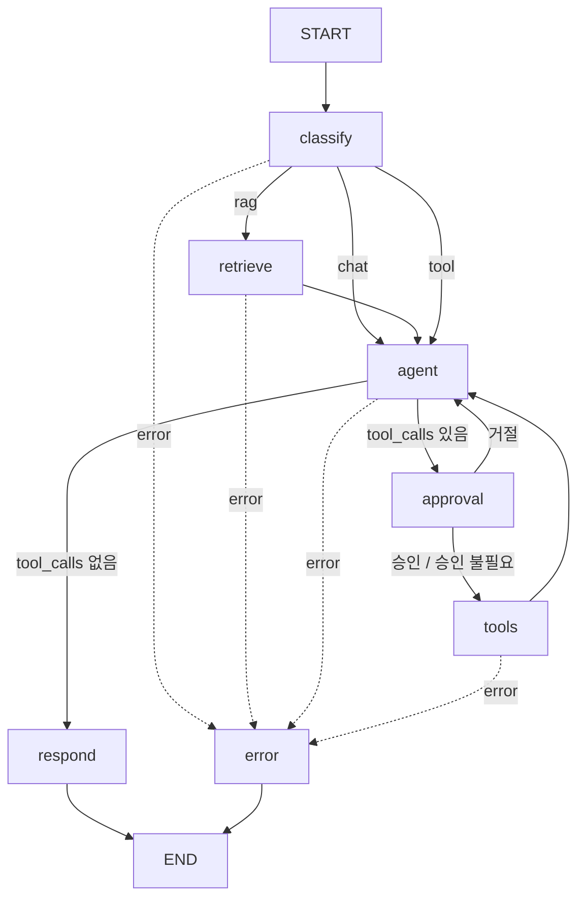

# CLAUDE.md — LangGraph AI Agent 예제

이 저장소는 **LangGraph 기반 AI Agent workflow 예제**다. 팀원이 새 Agent를 만들 때 참고하는 레퍼런스 코드가 목적이므로, 기능을 많이 넣는 것보다 **구조가 잘 보이고 읽기 쉬운 코드**를 우선한다.

---

## 1. 전체 맥락 (먼저 이해할 것)

```
[공통 대화창 UI] → [FastAPI (이미 구현됨)] → [이 저장소: LangGraph workflow] → 응답
```

- **UI**: 공통 대화창이 이미 제공된다. 이 저장소에서 다루지 않는다.
- **FastAPI**: 이미 구현되어 있고, API 요청을 받으면 workflow를 호출한다. 이 저장소에서 다루지 않는다.
- **이 저장소의 범위**: workflow, 즉 **State 설계 + 노드 구현 + 그래프(flow) 조립 + 로컬 툴** 만 만든다.

### 범위에 포함
- LLM 호출 + 시스템 프롬프트
- 질의 의도 분류 (Structured Output)
- Tool Calling + ReAct 루프 (Agent ⇄ Tool, 로컬 툴만 사용)
- HITL interrupt/resume용 체크포인터 (멀티턴 대화 기억 용도 아님 — 5.7 참고)
- RAG (로컬 문서 검색 + 출처 표시)
- Human-in-the-loop (특정 툴 실행 전 승인, `interrupt`)
- 에러 처리 노드

### 범위에서 제외 (만들지 말 것)
- FastAPI 라우터, 엔드포인트, SSE 구현
- UI
- MCP, 그 외 외부 API 연동 — 전부 로컬 툴로만 구현한다 (아래 예외 제외)
- 멀티 에이전트 / A2A / Supervisor 패턴
- 트레이싱, Guardrail, Eval 같은 운영 기능

### 환경 제약
- **사내 시스템을 사용하지 않는다.** 사내 DB, 사내 API 연동 금지.
- **외부 API 직접 호출 금지.** MCP 연동도 없음, 전부 로컬 툴만 (아래 예외 제외).
  - **예외: Tavily 검색 API.** 웹 검색이 필요해서 `tools/local_tools.py`의 `search_web` 툴이 Tavily API를 직접 호출한다. 그 외 외부 API는 추가하지 않는다.
- 그 외 로컬 툴은 **저장소 안의 자체 데이터(JSON/SQLite/파일)** 만으로 동작해야 한다.
- 특정 업무 도메인/주제는 정하지 않는다. 툴과 문서는 **범용 샘플**로 만든다.

---

## 2. 기술 스택

- Python 3.11+
- `langgraph`, `langchain-core`
- LLM: `langchain`의 `init_chat_model`로 생성하고, 모델명/공급자는 **환경변수로 주입**한다 (특정 공급자에 하드코딩 금지)
- 임베딩: 마찬가지로 환경변수로 주입
- 벡터스토어: `InMemoryVectorStore` 기본 (교체 가능하게 함수 하나로 감쌀 것)
- 설정: `pydantic-settings` + `.env`
- 테스트: `pytest`, `pytest-asyncio`

> 라이브러리 API가 버전에 따라 달라질 수 있으니, 구현 전에 설치된 버전의 실제 시그니처를 확인하고 맞춘다.

---

## 3. FastAPI와의 연결 계약 (Interface)

FastAPI는 이미 존재하므로, workflow는 아래 형태로 **노출만** 한다. 실제 호출 방식이 다르면 FastAPI 쪽 코드에 맞춰 이 부분만 조정한다.

```python
# src/agent/graph.py
async def build_graph() -> CompiledStateGraph:
    """앱 시작 시 1회 호출. 로컬 툴 로딩, RAG 인덱싱 후 컴파일된 그래프 반환."""
```

호출 예 (FastAPI 쪽에서 이렇게 쓴다고 가정):

```python
graph = await build_graph()  # startup 시 1회

# 대화 이력은 UI가 들고 있다가 매 요청마다 전체를 함께 보낸다 (서버는 이전 턴을 기억하지 않음).
# thread_id는 이 요청(턴) 하나를 위해 새로 발급한다 — HITL interrupt/resume에만 쓰인다.
config = {"configurable": {"thread_id": new_thread_id()}}

# 일반 질의 (messages에 지금까지의 전체 대화 이력 + 새 질문을 담아 보낸다)
result = await graph.ainvoke({"messages": full_history + [HumanMessage(content=query)]}, config)

# 스트리밍 (FastAPI가 SSE로 변환)
async for event in graph.astream_events({"messages": [...]}, config, version="v2"):
    ...

# HITL 승인 후 재개 (같은 턴의 같은 thread_id로)
await graph.ainvoke(Command(resume={"approved": True}), config)
```

규칙:
- **그래프는 반드시 async로 호출 가능해야 한다.** (LLM 호출이 async이기 때문)
- 툴 로딩/인덱싱은 **요청마다 하지 않는다.** `build_graph()`에서 1회.
- `thread_id`는 멀티턴 메모리용이 아니라 **HITL interrupt/resume**을 위한 턴 단위 식별자다. 대화 이력은 UI가 관리하고 매 요청에 전체를 실어 보낸다 (5.8 참고).
- interrupt 발생 시 FastAPI가 승인 요청을 UI에 보여줄 수 있도록, interrupt payload 형식을 고정한다 (5.5 참고).

---

## 4. 디렉토리 구조

```
.
├── CLAUDE.md
├── pyproject.toml
├── .env.example
├── src/agent/
│   ├── __init__.py
│   ├── config.py           # Settings (pydantic-settings)
│   ├── state.py            # AgentState 정의
│   ├── graph.py            # build_graph(): 노드/엣지 조립
│   ├── routing.py          # 조건부 엣지 함수 모음
│   ├── llm.py              # LLM / 임베딩 생성
│   ├── prompts.py          # 시스템 프롬프트, 분류 프롬프트
│   ├── nodes/
│   │   ├── classify.py     # 질의 의도 분류
│   │   ├── retrieve.py     # RAG 검색
│   │   ├── agent.py        # LLM 호출 (툴 바인딩)
│   │   ├── approval.py     # HITL 승인 (interrupt)
│   │   ├── respond.py      # 최종 응답 정리 (출처 포함)
│   │   └── error.py        # 에러 안내 메시지
│   ├── tools/
│   │   ├── local_tools.py  # 로컬 샘플 툴
│   │   └── registry.py     # 로컬 툴 목록, 승인 대상 목록
│   └── rag/
│       ├── loader.py       # data/docs 문서 로딩/청크 분할
│       └── retriever.py    # 벡터스토어 생성 및 검색
├── data/
│   ├── docs/               # RAG용 샘플 문서 (.md)
│   └── sample_items.json   # 로컬 툴용 샘플 데이터
├── scripts/
│   └── run_local.py        # FastAPI 없이 CLI로 workflow 테스트
└── tests/
```

---

## 5. 상세 설계

### 5.1 State

```python
class AgentState(TypedDict):
    messages: Annotated[list[AnyMessage], add_messages]  # 대화 이력
    intent: Literal["chat", "rag", "tool"] | None         # 분류 결과
    retrieved_docs: list[Document]                        # RAG 검색 결과
    error: str | None                                     # 에러 메시지
```

- 툴 실행 결과는 별도 필드 없이 `messages`의 `ToolMessage`로 관리한다 (LangGraph 표준 방식).
- 매 턴 시작 시 `intent`, `retrieved_docs`, `error`는 초기화된다 (분류 노드에서 덮어씀).

### 5.2 노드

| 노드 | 파일 | 역할 |
|---|---|---|
| `classify` | nodes/classify.py | 마지막 사용자 질의를 `chat / rag / tool` 중 하나로 분류. `with_structured_output` 사용 |
| `retrieve` | nodes/retrieve.py | 벡터스토어에서 상위 k개 문서 검색 → `retrieved_docs` |
| `agent` | nodes/agent.py | 시스템 프롬프트 + (RAG면 검색 문서 컨텍스트) + 대화 이력으로 LLM 호출. `intent == "tool"`일 때만 툴 바인딩 |
| `approval` | nodes/approval.py | 승인 대상 툴 호출이 있으면 `interrupt()`로 중단, 거절 시 거절 `ToolMessage` 추가 후 agent로 복귀 |
| `tools` | graph.py | `langgraph.prebuilt.ToolNode` 사용. 로컬 툴 실행 |
| `respond` | nodes/respond.py | 최종 AI 메시지 정리. RAG 사용 시 출처(문서명) 덧붙임 |
| `error` | nodes/error.py | `state.error`를 사용자용 안내 메시지로 변환해 종료 |

### 5.3 Flow



- **조건부 엣지 함수는 전부 `routing.py`에 모은다.** (분기 로직을 한 곳에서 보이게)
- Agent ⇄ Tool 루프에는 **최대 반복 횟수**를 둔다 (`recursion_limit` 또는 State 카운터). 기본 10.
- 에러 처리: 각 노드는 예외를 잡아 `{"error": "..."}`를 반환하고, 라우팅 함수가 `error`가 있으면 `error` 노드로 보낸다. 노드 안에서 예외를 그대로 던지지 않는다.

### 5.4 툴

**로컬 샘플 툴** (`tools/local_tools.py`) — 주제 중립적인 범용 툴로 만든다. 툴의 "종류"를 보여주는 게 목적이다.

| 툴 | 유형 | 설명 |
|---|---|---|
| `get_current_datetime` | 조회 | 현재 날짜/시간 반환 (인자 없는 가장 단순한 툴 예시) |
| `calculate` | 계산 | 사칙연산 수식 계산. `eval` 금지, 안전한 파서 사용 |
| `search_items` | 조회 | `data/sample_items.json`에서 키워드/카테고리로 검색 (인자 있는 조회 툴 예시) |
| `search_web` | 조회(외부) | Tavily 검색 API로 웹 검색 (유일한 외부 API 호출 툴, 환경 제약의 예외) |
| `save_note` | **변경** | 메모를 로컬 파일/SQLite에 저장. **HITL 승인 대상** |

- 각 툴은 `@tool` 데코레이터 + **명확한 docstring**(LLM이 언제 써야 하는지 판단하는 근거)을 갖는다.
- 인자는 Pydantic 스키마 또는 타입힌트로 명시한다.

**툴 레지스트리** (`tools/registry.py`)
```python
async def load_tools() -> list[BaseTool]:      # 로컬 툴 목록 반환
REQUIRES_APPROVAL: set[str] = {"save_note"}     # 승인 대상 툴 이름
```

### 5.5 Human-in-the-loop

- `approval` 노드는 마지막 AI 메시지의 `tool_calls` 중 `REQUIRES_APPROVAL`에 해당하는 게 있을 때만 `interrupt()`를 호출한다.
- interrupt payload 형식 (FastAPI/UI와의 계약이므로 고정):
  ```python
  {"type": "approval_request", "tool": "<툴 이름>", "args": {...}, "message": "<사용자에게 보여줄 설명>"}
  ```
- resume 값: `{"approved": bool}`
- 거절 시 해당 tool_call에 대해 "사용자가 실행을 거절했습니다" 내용의 `ToolMessage`를 추가하고 agent로 돌아간다 (LLM이 상황을 인지하고 답하도록).
- interrupt를 쓰려면 checkpointer가 필수다.

### 5.6 RAG

- `data/docs/*.md`에 샘플 문서 3~5개를 둔다 (주제 중립적인 내용, 예: 가상 서비스 이용 안내, FAQ 등).
- `build_graph()`에서 1회 로딩 → 청크 분할 → 임베딩 → 벡터스토어 생성.
- 검색 결과는 `retrieved_docs`에 저장하고, agent 노드에서 컨텍스트로 프롬프트에 주입한다.
- `respond` 노드에서 사용된 문서의 파일명을 출처로 표시한다.

### 5.7 체크포인터 (멀티턴 대화 기억은 서버 책임 아님)

- 대화 이력은 **UI/클라이언트가 들고 있다가 매 요청마다 전체를 함께 보낸다.** 서버가 이전 턴을 기억하기 위해 state를 영속시키지 않는다.
- checkpointer는 오직 **HITL interrupt/resume** 때문에 필요하다 (`interrupt()`로 멈춘 그래프를 이어서 실행하려면 LangGraph 구조상 checkpointer가 필수). 대화 메모리 용도가 아니다.
- 기본 checkpointer는 `InMemorySaver` (예제용). 교체 가능하게 `build_graph(checkpointer=...)` 인자로 받는다.
- `thread_id`는 **요청(턴) 단위로 발급**한다. 같은 사용자의 이전 턴과 공유하지 않는다 — 공유하면 checkpointer에 쌓인 이전 메시지와 클라이언트가 다시 보낸 전체 히스토리가 중복된다.

### 5.8 스트리밍 고려사항

- 스트리밍 구현 자체는 FastAPI 쪽 책임이다.
- 단, FastAPI가 `astream_events`로 받을 때 의미 있는 이벤트가 나오도록 **노드 이름을 명확하게** 짓고, 최종 답변을 생성하는 LLM 호출은 streaming 가능한 방식으로 호출한다.
- 분류(classify) 노드의 LLM 출력은 사용자에게 보일 필요가 없으므로, FastAPI가 필터링할 수 있게 해당 LLM 호출에 `tags=["internal"]`을 붙인다.

---

## 6. 코딩 규칙

- **예제 코드다.** 과도한 추상화(베이스 클래스, 팩토리 계층, DI 프레임워크) 금지. 함수 위주로 단순하게.
- 각 파일 상단에 **이 파일이 workflow에서 어떤 역할인지** 한국어 주석으로 2~3줄 설명.
- LangGraph 핵심 개념이 쓰이는 지점(조건부 엣지, interrupt, ToolNode, checkpointer, add_messages 등)에는 **왜 이렇게 쓰는지** 한국어 주석을 단다.
- 프롬프트는 전부 `prompts.py`에 모은다. 노드 코드에 프롬프트 문자열을 흩어두지 않는다.
- 설정값(모델명, k값, 최대 반복 등)은 `config.py`에서만 읽는다. 하드코딩 금지.
- 타입힌트 필수. 로깅은 `logging` 표준 모듈 사용 (`print` 금지, 단 `scripts/`는 예외).
- 비밀값(API 키)은 `.env`로만. `.env.example`에는 키 이름만.

---

## 7. 구현 순서

한 번에 다 만들지 말고 단계마다 `scripts/run_local.py`로 동작을 확인하며 진행한다.

1. **뼈대**: `pyproject.toml`, `config.py`, `state.py`, `llm.py`, `.env.example`
2. **최소 그래프**: `START → agent → respond → END` 로 단순 대화 동작 확인
3. **체크포인터**: checkpointer 붙이기 (멀티턴 대화 기억용이 아니라 이후 HITL interrupt/resume을 위한 선행 작업)
4. **로컬 툴 + ReAct 루프**: `tools/local_tools.py`, `ToolNode`, agent ⇄ tools 루프
5. **분류 노드**: `classify` + `routing.py` 조건부 엣지
6. **RAG**: `rag/`, `retrieve` 노드, 출처 표시
7. **HITL**: `approval` 노드, interrupt/resume 확인
8. **에러 처리**: `error` 노드, 각 노드 예외 처리
9. **테스트 + README**: 노드 단위 테스트, 라우팅 함수 테스트, 실행 방법 문서화

## 8. 완료 기준

- [ ] `scripts/run_local.py`로 일반 대화 / 문서 질의 / 툴 사용 질의가 각각 의도한 경로로 흐른다
- [ ] UI가 전체 대화 이력을 매 요청에 함께 보내면 그 이력을 그대로 이어받아 답한다 (서버는 턴 간 메모리를 따로 저장하지 않음)
- [ ] `save_note` 호출 시 interrupt가 발생하고, 승인/거절 각각 정상 처리된다
- [ ] RAG 응답에 출처가 표시된다
- [ ] 툴/노드 예외 발생 시 error 노드를 거쳐 안내 메시지로 종료된다
- [ ] `pytest` 통과
- [ ] README에 실행 방법과 FastAPI 연결 방법(3장 계약)이 정리되어 있다
