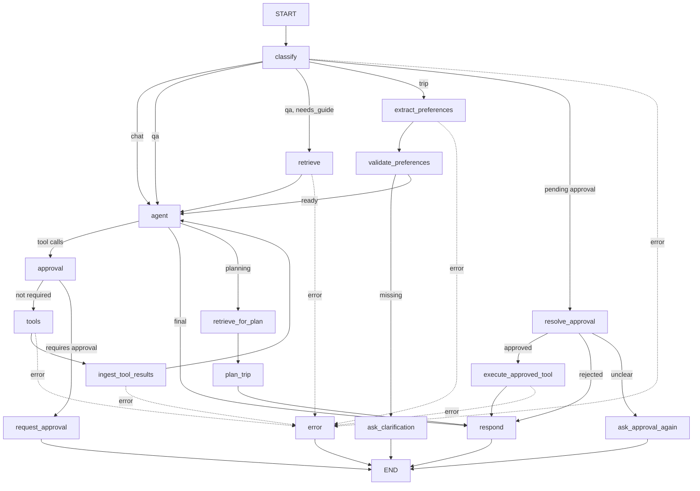

# Sports Trip Planner Agent — Claude Code 구현 명세서

> 버전: v1.0 / 목적: 기존 `CLAUDE.md`의 LangGraph 학습 예제를 **야구 경기 연계 여행 플래너**로 구현한다.
>
> **Claude Code 실행 지시:** 이 문서와 저장소의 `CLAUDE.md`를 읽고, 아래의 *변경 우선순위*를 적용하여 단계별로 구현하라. 각 단계에서 `scripts/run_local.py`와 pytest로 검증하라. 예제의 가독성을 최우선으로 한다.

## 0. 변경 우선순위와 구현 경계

- 이 문서는 **스포츠 여행 도메인과 메모리 상태 관리에 한하여** 기존 `CLAUDE.md`보다 우선한다. 나머지 코딩 규칙·기술 스택·에러 처리·스트리밍 고려사항은 원본을 따른다.
- **구현 범위:** `src/agent` LangGraph workflow, State, 노드, 라우팅, 로컬 Tool, RAG, 샘플 데이터, CLI, 테스트.
- **구현 제외:** FastAPI 엔드포인트, UI, SSE 서버, MCP, A2A, 멀티 에이전트, 운영용 트레이싱/Guardrail/Eval, 실제 예매·결제·지도/경로 API.
- **외부 호출:** 없음. 모든 검색/저장 Tool은 로컬 JSON/파일로 처리. 웹 검색(Tavily)은 사용하지 않는다. 사내 데이터·사내 API 금지.
- **상태 관리 변경:** 이전 문서의 “UI가 전체 대화 이력을 매번 전달, Checkpointer 없음”을 **로컬 `InMemorySaver` + 고정 `thread_id`**로 변경한다. CLI가 같은 컴파일 그래프 인스턴스를 재사용한다. Python 프로세스가 종료되면 상태가 사라진다. 전역 변수에 여행 상태를 별도로 복제하지 않는다.
- **외부 API 계약:** 기존 `build_graph() -> CompiledStateGraph`, `ainvoke(...)` 및 `result['answer']` 개념을 유지한다. 다만 로컬 CLI에서는 첫 호출 이후 **`user_input`만 전달**하고 동일한 `config={'configurable': {'thread_id': 'local-demo'}}`를 사용한다. 기존 UI/FastAPI가 이 계약으로 호출하지 않는다면 어댑터 변경이 필요하다. 이 프로젝트에서 서버 코드는 수정하지 않는다.
- **승인 방식:** 기존 `interrupt()` 미사용 원칙 유지. `pending_approval`을 State에 기록하고 다음 입력의 승인/거절로 처리한다. `ToolNode` 호출 메시지의 무결성을 보장할 수 없다면 승인된 저장 Tool을 명시적인 노드에서 직접 호출해도 된다(아래 7장 참조).
- **주제:** KBO 야구 우선. 향후 골프 확장을 위해 데이터의 `sport_type`을 유지하지만 골프 기능 자체는 v1에 구현하지 않는다.

## 1. 사용자 경험 및 완료 시나리오

1. “롯데 경기 보고 여행 가고 싶어” → 날짜 범위와 여행 기간을 한 번에 질문한다.
2. “다음 달 토요일 중 1박 2일” → 이전 팀 조건을 유지하고 날짜 범위를 정규화해 경기 후보를 검색한다.
3. 후보가 여러 개면 날짜·상대 팀·경기장·출처를 제시하고 사용자의 선택을 기다린다. 0개면 임의 경기 생성 없이 대안을 안내한다.
4. “두 번째 경기로” → 후보 ID를 선택하고 경기 시각을 고정해 관광지/식당을 검색하고 일정을 작성한다.
5. “차 없이 갈 거고 둘째 날 바다 관광 추가해 줘” → 선택 경기는 유지하고 이동수단·관광 선호도를 반영해 기존 일정을 수정한다.
6. “일정 저장해 줘” → 승인 요청. 다음 턴 “승인” → 로컬 저장; “거절” → 저장하지 않는다.
7. “야구장 준비물은?” → `search_guide_docs` 툴로 로컬 문서를 찾아 근거로 답변하고 문서명 출처를 표기한다.
8. “이번 주 롯데 경기만 알려줘” → 여행 기간을 묻지 않고 경기 일정만 검색한다.

**원칙:** 모든 날짜·장소·경기·영업정보는 데이터 출처를 구분한다. 샘플 일정은 실제 확정 경기로 표현하지 않는다. 영업시간·이동시간처럼 확인할 수 없는 정보는 “확인 필요”로 표시한다.

## 2. 전체 Workflow



- `classify`: 승인 대기가 있으면 일반 의도 분류보다 **승인 처리 우선**. 그 외 `chat/trip/qa` 분류. `qa`는 여행 계획 수립이 아닌 질문/요청(가이드 안내, 경기 일정 조회, 일정 저장 등)이다. 같은 구조화 출력에 `needs_guide`(가이드 문서가 있어야 답할 수 있는 질문인가)를 함께 받는다. `with_structured_output` 사용.
- `extract_preferences`: 대화 이력, 기존 `trip_preferences`, 현재 입력을 종합해 **명시적 수정만 덮어쓰기**. 상대 날짜는 `get_current_datetime` 기준으로 해석하고 범위 조건(예: 토요일)을 보존한다.
- `validate_preferences`: LLM 없는 결정적 검사. 누락 조건/선택 필요 여부를 판단한다.
- `ask_clarification`: 필수 조건을 한 질문에 묶어 `answer` 반환 후 종료.
- `retrieve`: RAG 문서 상위 k개 검색. 검색을 LLM의 툴 선택에 맡기지 않고 **코드로 강제**한다. (1) `needs_guide=True`인 질문은 `agent` 전에, (2) 일정 작성은 `plan_trip` 직전에(`retrieve_for_plan`, 조건으로 만든 고정 질의) 항상 검색한다. 보충 검색용으로 `search_guide_docs` 툴도 `agent`에 남기고, 그 결과는 `ingest_tool_results`가 `retrieved_docs`에 반영한다.
- `agent`: 검색 Tool 선택 → 관찰 → 다음 Tool 선택의 ReAct 루프. 여행 계획은 검증 가능한 데이터만 근거로 작성한다.
- `approval/request_approval/resolve_approval/execute_approved_tool`: 승인 대기 정보를 메모리 State에 보존하고 다음 턴에서 검증·실행한다.
- `tools`: `ToolNode`; `ingest_tool_results`는 ToolMessage의 구조화된 결과를 State 검색 캐시에 반영한다. 같은 ToolMessage를 반복 처리하지 않도록 처리한 호출 ID를 추적하거나, 마지막 실행 묶음만 대상으로 삼는다.
- `respond`: 최종 `answer`를 정리하고 RAG 출처를 표기한다.
- `error`: 실패한 작업과 재시도 가능한 조건을 안내한다.
- **라우팅 함수는 모두 `routing.py`에 둔다.** 최대 Tool 반복 10회, 무한 루프 금지. 오류 분기는 각 노드의 예외를 `error` 필드에 기록한 뒤 `error` 노드로 보낸다.

## 3. State 스키마

```python
from typing import Annotated, Any, Literal, NotRequired, TypedDict
from langchain_core.documents import Document
from langchain_core.messages import AnyMessage
from langgraph.graph.message import add_messages

class TripPreferences(TypedDict, total=False):
    sport_type: str                 # 기본 baseball
    team: str                       # 예: 롯데 자이언츠
    destination: str                # 경기장으로 추론 가능
    date_from: str                  # YYYY-MM-DD, 검색 시작
    date_to: str                    # YYYY-MM-DD, 검색 종료
    preferred_weekdays: list[int]   # 월=0 ... 일=6
    duration_days: int              # 1박2일 = 2
    travelers: int
    transport: str                  # public_transit/car/unspecified
    budget_krw: int
    interests: list[str]

class AgentState(TypedDict, total=False):
    messages: Annotated[list[AnyMessage], add_messages]
    user_input: str
    intent: Literal['chat', 'trip', 'qa'] | None
    trip_preferences: TripPreferences
    missing_fields: list[str]
    sports_events: list[dict[str, Any]]
    selected_event_id: str | None
    places: list[dict[str, Any]]
    restaurants: list[dict[str, Any]]
    trip_plan: dict[str, Any] | None
    pending_approval: dict[str, Any] | None
    processed_tool_call_ids: list[str]
    retrieved_docs: list[Document]
    trip_status: Literal['idle','collecting','searching','selecting','planning','completed']
    error: str | None
    answer: str

class InputState(TypedDict):
    user_input: str
    messages: NotRequired[list[AnyMessage]]  # CLI에서는 생략; 첫 초기화/호환성 용도

class OutputState(TypedDict):
    answer: str
```

**중요 구현 메모:** `OutputState`가 `answer`만 노출해도 체크포인터는 그래프 내부 State를 유지한다. `StateGraph(AgentState, input_schema=InputState, output_schema=OutputState)`를 사용하고, 체크포인터와 같은 `thread_id`를 통해 이어 실행한다. `messages`에 이번 사용자 입력을 정확히 한 번 추가한다. `user_input`, `intent`, `missing_fields`, `retrieved_docs`, `error`, `answer`는 턴 시작 시 적절히 초기화한다. 여행 조건, 검색 캐시, 선택 경기, 계획, 승인 대기는 의도에 따라 유지한다.

**선택과 수정 정책:** `selected_event_id`는 반드시 현재 `sports_events`의 실제 ID를 참조해야 한다. 팀/날짜 범위가 바뀌면 기존 선택과 관련 계획을 무효화한다. 인원/이동수단/관심사만 바뀌면 선택 경기는 유지하고 계획을 재생성한다. 저장 승인 대기 중 다른 주제의 입력이 들어오면 승인 대기를 취소하거나 재확인하고, 예전 승인으로 실행하지 않는다.

## 4. 조건 수집 정책

- `trip` 의도에서 필수: **팀 또는 특정 경기**, **검색 가능한 날짜/기간 범위**, **여행 일수**. `sport_type` 기본값은 `baseball`.
- 날짜 표현 “다음 달”, “이번 주”, “11월 첫째 주”, “토요일 중”은 기준 현재 날짜로 정규화한다. 모호하거나 모순되면 확인 질문한다.
- 지역은 선택된 경기장으로 결정할 수 있다. 인원/예산/교통/선호는 선택 사항이며 없는 값을 사실처럼 채우지 않는다.
- 경기 후보가 여러 개면 번호와 **event_id**를 함께 State에 저장하고, 사용자가 번호로 선택할 수 있게 한다.
- 경기 일정 조회만 요청한 `tool` 의도에서는 여행 기간 등 여행 계획 조건을 강제하지 않는다.
- 경기 0건 시 임의 경기를 만들지 않고 날짜 범위나 팀 조건을 바꾸도록 제안한다.

## 5. Tool 명세 및 데이터

| Tool | 입력 | 결과 | 출처 |
|---|---|---|---|
| `get_current_datetime` | 없음 | ISO 날짜/시간, 타임존 | 로컬 시스템 |
| `search_sports_events` | `sport_type`, `team?`, `start_date?`, `end_date?`, `city?` | `events[]` | `data/sports_events.json` |
| `search_places` | `city`, `category?`, `near_venue?`, `limit=5` | `places[]` | `data/tourist_places.json` |
| `search_restaurants` | `city`, `cuisine?`, `near_venue?`, `limit=5` | `restaurants[]` | `data/restaurants.json` |
| `save_trip_plan` | `trip_plan` | `saved_id`,`path` | 로컬 JSON/SQLite |

- 각 Tool에 `@tool`, 타입 힌트, LLM이 사용 조건을 이해할 수 있는 한국어 docstring을 작성한다.
- Tool 응답 형식은 `{status, source, data, error?}`처럼 통일한다. JSON 직렬화 가능한 자료형만 반환한다.
- 검색 결과에 `id`, `source_type`(v1은 `sample`), `source_url?`, `verified_at?`를 포함한다.
- 샘플 경기 데이터는 실제 일정처럼 오인되지 않도록 `source_type: sample`, `is_demo: true`를 명시한다. 실제 경기와 유사한 날짜를 쓰더라도 **가상 데이터**라고 출력한다.
- 장소 데이터에는 `place_id`, `name`, `city`, `category`, `address`, `estimated_duration_min`, 선택적 좌표를 둔다.
- 일정 데이터에는 `day`, `start_at`, `end_at`, `place_id?`, `event_id?`, `activity`, `notes`, `is_estimated`를 둔다.
- Tool 실패 시 예외를 포착해 Tool 오류 결과를 반환하고, 가능한 부분만 안내한다.
- 승인 대상 Tool은 설정(`APPROVAL_REQUIRED_TOOLS`)으로 바꿀 수 있게 하되 **기본값은 `save_trip_plan` 승인 필요**로 둔다.
- 실제 티켓 예약, 호텔 예약, 결제 기능은 구현하지 않는다.

### 샘플 파일 구조

```text
data/
  sports_events.json
  tourist_places.json
  restaurants.json
  saved_trips.json
  docs/
    baseball_guide.md
    travel_guide.md
    transport_guide.md
```

야구 샘플은 최소 5경기, 관광지는 8곳, 식당은 8곳 이상으로 만들고, **부산/사직야구장** 시나리오를 충분히 테스트할 수 있게 한다. 샘플 경기 날짜는 테스트의 결정성을 위해 고정 날짜로 만들고, CLI 데모에서는 그 날짜를 명시해 실행한다. “다음 달” 시나리오를 테스트할 때는 기준 날짜를 주입 가능한 함수로 분리해 날짜 경계에서 테스트가 깨지지 않게 한다.

## 6. 일정 생성 및 검증

1. 사용자 조건 확인 → 경기 후보 검색 → 선택 확정 → 관광지/식당 검색 → 일정 생성.
2. 선택된 경기의 `start_at`은 **변경 불가능한 고정 일정**이다.
3. 야구 종료 시각은 확정하지 않고 예상 시간으로 표기한다. 입장 여유 시간을 고려한다.
4. 여행 기간에 맞춰 Day 1/Day 2/Day 3으로 구성한다.
5. 이동 시간·영업시간을 확인할 API가 없으므로 임의의 정밀 수치를 만들지 않는다. 필요한 경우 “예상/확인 필요”라고 표시한다.
6. 기존 일정 수정 시 선택 경기 및 변경하지 않은 조건을 유지한다.
7. Python 함수 `validate_trip_plan(plan, selected_event)`을 별도 작성해 시간 역전, 활동 중복, 여행 범위 이탈, 경기 시작 시각 불일치, 선택 경기 누락을 검사한다. 검증 실패 시 한 번 수정하거나 사용자에게 제약을 설명한다.
8. 계획에는 경기 및 장소 출처를 포함하고, 샘플(가상) 데이터임을 사용자에게 알린다.

## 7. HITL (대화형 승인)

- 승인 대상 기본값: `{'save_trip_plan'}`.
- 승인 필요 Tool 호출 시 `pending_approval = {approval_id, tool_name, arguments, requested_at}` 저장, `answer`에 대상과 인자를 설명하고 턴 종료.
- 다음 턴은 `pending_approval` 우선 확인. 명확한 승인(예/승인/진행)만 실행하고 거절(아니오/취소)은 실행하지 않는다. 모호한 답은 다시 질문한다.
- 승인 시 **State에 저장된 인자 그대로** 실행한다. 새로운 LLM이 인자를 다시 생성하게 하지 않는다. 승인 전후 `tool_name`, `arguments`, `approval_id`가 일치해야 한다.
- 승인/거절 후 `pending_approval=None`으로 초기화한다. 동일 승인을 재실행하지 않는다.
- 기존 `ToolNode`는 직전 AIMessage의 `tool_calls`에 의존하므로, **턴을 건너 승인된 실행**은 `execute_approved_tool` 노드에서 레지스트리의 허용된 Tool을 검증 후 직접 호출하고 결과를 State에 반영하는 방식을 권장한다. 일반 승인 불필요 Tool은 기존 `ToolNode` 사용.
- `save_trip_plan` 승인 후에는 저장 결과를 반환한다. 승인 대상이 추가되어 결과를 이어서 써야 하는 Tool이면 **Agent로 복귀**하도록 Tool별로 분기한다.
- 로컬 학습용이지만 승인되지 않은 파일 쓰기, 임의 Tool 이름 실행, 승인 요청 재사용을 막는다.

## 8. RAG

- `data/docs/*.md` 문서 3개 이상: 야구 관람 준비/가이드, 여행 일정 원칙, 대중교통 동선 가이드.
- `build_graph()`에서 **한 번만** 로드·청킹·임베딩·`InMemoryVectorStore` 인덱싱한다.
- `retrieve`/`retrieve_for_plan`이 상위 k개를 검색하고(`needs_guide` 질문과 일정 작성 시 강제), `respond`가 사용된 문서명을 출처로 표기한다. `plan_trip`도 검색된 문서를 일정 작성 참고로 쓴다.
- 가이드 문서는 일반 안내용이며 실제 경기 일정 확인은 검색 Tool을 사용한다.
- 임베딩 공급자와 모델은 `.env` / `pydantic-settings`로 주입한다.

## 9. 구현 디렉터리

```text
src/agent/
  config.py
  state.py
  graph.py
  routing.py
  llm.py
  prompts.py
  nodes/
    classify.py
    extract_preferences.py
    validate_preferences.py
    ask_clarification.py
    retrieve.py
    agent.py
    approval.py
    respond.py
    error.py
    ingest_tool_results.py
  tools/
    local_tools.py
    registry.py
  rag/
    loader.py
    retriever.py
    guide_tool.py
scripts/
  run_local.py
tests/
  test_routing.py
  test_preferences.py
  test_tools.py
  test_trip_validation.py
  test_multiturn.py
  test_approval.py
```

`resolve_approval`, `execute_approved_tool`, `request_approval`, `ask_approval_again`은 구현을 단순하게 유지할 수 있다면 `nodes/approval.py`에 함께 정의한다. 일정 검증 함수는 `nodes/agent.py`에 과도하게 섞지 말고 `trip_validation.py` 등 작은 모듈로 분리해도 된다.

## 10. CLI와 초기화

```python
# 개념 예시 — 실제 LangGraph 버전에 맞춰 구현
from langgraph.checkpoint.memory import InMemorySaver

async def build_graph():
    # LLM/Tool/RAG를 1회 준비한 뒤 그래프 컴파일
    return workflow.compile(checkpointer=InMemorySaver())

async def main():
    graph = await build_graph()  # 프로세스 내 1회
    config = {'configurable': {'thread_id': 'local-demo'}}
    while True:
        query = input('User> ').strip()
        if query in {'exit', 'quit'}:
            break
        result = await graph.ainvoke({'user_input': query}, config=config)
        print('Agent>', result['answer'])
```

- 실제 `build_graph()`에서는 `workflow` 생성, 노드/조건부 엣지 연결, Tool/RAG 초기화를 구현한다.
- 한 턴의 `answer`가 체크포인트에 남아 다음 턴에 섞이지 않도록 초기화한다.
- CLI `reset` 명령을 제공해 새 `thread_id`로 시작하거나 새 그래프/Checkpointer를 생성할 수 있게 한다.
- 테스트 시 `graph.get_state(config)`로 `trip_preferences`, `selected_event_id`, `trip_plan`, `pending_approval`를 검증한다.

## 11. 테스트/완료 기준

| ID | 입력 / 상황 | 기대 결과 |
|---|---|---|
| T01 | “안녕” | 일반 대화 경로 |
| T02 | “야구장 준비물 알려줘” | `needs_guide`로 `retrieve` 강제 실행(Agent가 툴을 안 불러도), 문서 출처 표시 |
| T03 | “롯데 경기 일정 알려줘” | 경기 조회, 여행 기간 질문 없음 |
| T04 | “롯데 경기 보고 여행 가고 싶어” | 날짜·여행 일수 질문 |
| T05 | “다음 달 토요일 중 1박 2일” | 기존 팀 조건 유지, 날짜 필터 적용 |
| T06 | 경기 후보 다수 → “두 번째 경기” | 정확한 `event_id` 선택 |
| T07 | “대중교통으로 바꿔줘” | 선택 경기 유지, 일정 수정 |
| T08 | “일정 저장해줘” → “승인” | 한 번만 로컬 저장 |
| T09 | “일정 저장해줘” → “거절” | 저장하지 않음 |
| T10 | 경기 검색 0건 | 가짜 경기 생성 금지, 대안 안내 |
| T12 | 승인 대기 중 다른 요청 | 오래된 승인 자동 실행 금지 |
| T13 | 계획 시간 충돌 | 검증 실패 처리 |
| T14 | `reset` 후 새 요청 | 이전 여행 상태 없음 |

**완료 조건:** `pytest` 통과, 로컬 CLI 멀티턴 정상 작동, `get_state`로 상태 변화 확인, Tool 최대 반복 제한, RAG 출처 표기, HITL 승인/거절, README 실행 안내.

## 12. Claude Code 작업 순서

1. 원본 `CLAUDE.md`와 이 문서를 비교하고 변경점 확인. 기존 코드가 있다면 파괴적 수정 없이 먼저 구조 확인.
2. `config.py`, `state.py`, `llm.py`, `graph.py` 최소 구조와 `InMemorySaver` 적용. CLI에서 2턴 State 유지 확인.
3. 로컬 JSON 데이터와 Tool 작성, Tool 단위 테스트.
4. `classify`, `extract_preferences`, `validate_preferences`, `ask_clarification`, 라우팅 구현. 부족 조건 질문 및 멀티턴 병합 검증.
5. `agent` + `ToolNode` ReAct, 검색 결과 State 반영, 후보 선택 및 일정 생성 구현.
6. 여행 일정 검증 및 수정 흐름 구현.
7. RAG 문서, `retrieve`/`retrieve_for_plan` 노드, `search_guide_docs` 보충 툴 구현.
8. 대화형 HITL 및 승인된 Tool 직접 실행 구현. 승인 재사용 방지 테스트.
9. 에러 처리, 최대 반복 제한, README, 통합 테스트 마무리.

### 코딩 규칙

- Python 3.11+, `langgraph`, `langchain-core`, `pydantic-settings`, `pytest`, `pytest-asyncio`.
- `init_chat_model` 및 임베딩 모델은 환경변수 기반; 모델 제공자 하드코딩 금지.
- 프롬프트는 `prompts.py`에 집중; 노드 역할을 설명하는 한국어 주석.
- 과도한 추상화, 복잡한 DI, 멀티 에이전트 패턴 금지.
- 각 단계에서 동작을 확인하고, 설치된 LangGraph/LangChain API 시그니처에 맞춰 코드를 작성한다.
- 임의의 실제 경기·예약 가능 여부·이동 시간·영업시간을 생성하지 않는다.

---

**최종 요청:** 위 명세대로 코드를 구현하고, 테스트 결과와 남은 제약을 README에 정리하라. 기존 `CLAUDE.md`의 서버 연동 설명과 이 문서의 로컬 체크포인터 실행 계약이 다름을 명시하고, 실제 FastAPI 코드는 수정하지 말라.
