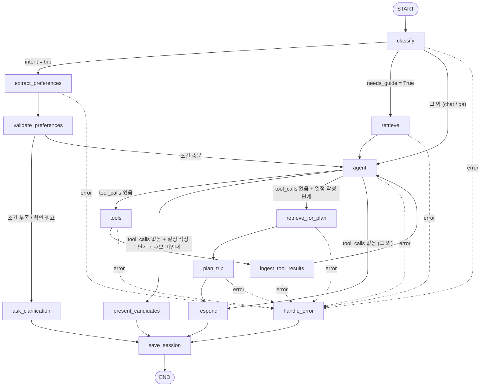

# 스포츠 여행 Agent 워크플로우 설계서

KBO 경기 관람과 여행 일정을 함께 계획해 주는 LangGraph workflow(`teams/team5/`)의 설계 문서다.
기준 코드: 2026-10-27 현재(일정 저장/승인 기능을 제거한 버전) `teams/team5/{state,workflow,routing,prompts}.py`, `teams/team5/nodes/*`.

> 참고: 실제 LLM으로 end-to-end 검증을 하지 않았다(테스트는 전부 가짜 LLM). 2장의 "개선 전 → 후"는 git 이력(`prompts.py` diff)과 코드 주석에 근거한 것이며, 실모델 정량 비교 결과가 아니다.

---

## 1. 워크플로우 설계

### 1.1 State 스키마

그래프 State는 `MyState`(`TypedDict, total=False`)이다. 호출자는 `messages`(이전 대화 이력)와 `user_input`(이번 질문)만 보내고, 결과로 `answer`를 받는다.
체크포인터가 없으므로 이력에 없는 여행 상태는 `session.py`의 프로세스 내 보관소가 턴 사이에 이어준다(★ 표시).

| 필드 | 타입 | 설명 |
|---|---|---|
| `messages` | `list[AnyMessage]` (`add_messages`) | 대화 이력. 노드가 반환한 메시지는 덮어쓰지 않고 뒤에 누적된다 |
| `user_input` | `str` | 이번 턴 사용자 질문. classify가 이력 끝에 한 번만 합친다 |
| `intent` | `"chat" \| "trip" \| "qa" \| None` | 의도 분류 결과 |
| `needs_guide` | `bool` | classify의 판단: 가이드 문서 검색이 필요한 질문인가. True면 agent 전에 `retrieve`를 강제한다 |
| `trip_preferences` ★ | `TripPreferences` | 누적된 여행 조건(아래 표) |
| `missing_fields` | `list[str]` | 부족한 필수 조건: `team`, `date_range`, `duration_days`, `trip_start` |
| `clarification_note` | `str \| None` | 날짜가 모호/모순일 때 extract가 남기는 확인 질문(사용자에게 그대로 보인다) |
| `sports_events` ★ | `list[dict]` | 경기 검색 결과 캐시. 번호 = 리스트 순서 + 1 |
| `event_notice` | `str \| None` | 지목한 경기가 없어 대안을 담았다는 알림. 턴마다 초기화 |
| `selected_event_id` ★ | `str \| None` | 사용자가 고른 경기 ID |
| `place_choice` ★ | `dict \| None` | 관광지/식당 후보 안내 상태 `{event_id, status: asked\|done, picked_ids}`. 경기가 바뀌면 무효 |
| `places` ★ | `list[dict]` | 관광지 후보 캐시 |
| `restaurants` ★ | `list[dict]` | 식당 후보 캐시 |
| `trip_plan` ★ | `dict \| None` | 검증을 통과한 최종 일정 |
| `trip_status` ★ | `"idle" \| "collecting" \| "searching" \| "selecting" \| "planning" \| "completed"` | 여행 계획 진행 단계 |
| `retrieved_docs` | `list[Document]` | RAG 검색 결과. agent 컨텍스트에 들어가고 respond가 출처로 표시한다 |
| `processed_tool_call_ids` | `list[str]` | 이미 캐시에 반영한 ToolMessage ID(중복 처리 방지) |
| `tool_iterations` | `int` | 이번 턴의 Tool 실행 횟수(최대 `AGENT_MAX_ITERATIONS`=10) |
| `error` | `str \| None` | 노드가 예외 대신 기록하는 오류 메시지 |
| `answer` | `str` | 호출자에게 돌려줄 최종 답(출력) |

`TripPreferences` (`total=False`)

| 필드 | 타입 | 설명 |
|---|---|---|
| `sport_type` | `str` | 기본 `baseball` |
| `team` | `str` | 응원 팀. 예: 롯데 자이언츠 |
| `destination` | `str` | 목적지(경기장으로 추론 가능) |
| `date_from`, `date_to` | `str` (YYYY-MM-DD) | 경기 검색 범위 또는 여행 기간 |
| `preferred_weekdays` | `list[int]` | 선호 요일. 월=0 … 일=6 |
| `duration_days` | `int` | 여행 일수. 1박 2일 = 2 |
| `travelers` | `int` | 인원 |
| `transport` | `str` | `public_transit` / `car` / `unspecified` |
| `budget_krw` | `int` | 예산(원) |
| `interests` | `list[str]` | 관심사. 여러 턴에 걸쳐 누적 |

턴 단위 값(`intent`, `needs_guide`, `missing_fields`, `clarification_note`, `event_notice`, `tool_iterations`, `retrieved_docs`, `error`, `answer`)은 classify가 매 턴 시작에 초기화한다.

### 1.2 노드 구성

전체 노드는 14개이고, LLM을 쓰는 노드는 classify, extract_preferences, agent, plan_trip 4개다. 나머지는 규칙/템플릿으로 동작해 결과가 결정적이다.

| 노드 | 역할 | LLM | 읽는 필드 | 쓰는 필드 |
|---|---|---|---|---|
| `classify` | 보관소에서 여행 상태 복원, 턴 값 초기화, `user_input`을 이력에 합침, 의도 + `needs_guide` 분류(Structured Output) | O | `messages`, `user_input`, `trip_status` | `messages`, `intent`, `needs_guide`, 복원한 여행 상태(★), 초기화 대상 턴 값, `error` |
| `extract_preferences` | 이번 입력에서 여행 조건/경기 선택/장소 선택을 추출해 기존 조건에 병합(Structured Output). 검색 조건이 바뀌면 후보·선택·일정 무효화 | O | `messages`, `trip_preferences`, `sports_events`, `selected_event_id`, `places`, `restaurants`, `place_choice`, `trip_plan`, `user_input` | `trip_preferences`, `clarification_note`, `sports_events`, `selected_event_id`, `trip_plan`, `places`, `restaurants`, `place_choice`, `error` |
| `validate_preferences` | 필수 조건(팀/경기, 날짜 범위, 일수, 여행 시작일) 충족 여부를 규칙으로 검사하고 `trip_status` 갱신 | X | `trip_preferences`, `selected_event_id`, `sports_events`, `clarification_note` | `missing_fields`, `trip_status` |
| `ask_clarification` | 채워진 조건과 부족한 조건을 보여주는 질문을 내보내고 턴 종료 | X | `missing_fields`, `trip_preferences`, `clarification_note`, `selected_event_id` | `messages`, `answer` |
| `retrieve` | 가이드 문서 검색 강제. 같은 구현을 두 위치에서 쓴다: `retrieve`(질의 = `user_input`, agent 전)와 `retrieve_for_plan`(질의 = 이동수단으로 만든 고정 질의, `plan_trip` 직전). 이미 찾은 문서와는 내용 기준으로 중복 제거 | X | `user_input`, `trip_preferences`, `retrieved_docs` | `retrieved_docs`, `error` |
| `agent` | 시스템 프롬프트 + 여행 상태 + 검색 문서 + 이력으로 LLM 호출. `trip`/`qa`일 때만 툴 바인딩(조회 툴 + 보충용 `search_guide_docs`). 반복 한도 초과 시 LLM 호출 없이 에러 | O | `messages`, `intent`, `trip_status`, `trip_preferences`, `sports_events`, `selected_event_id`, `places`, `restaurants`, `trip_plan`, `event_notice`, `retrieved_docs`, `tool_iterations` | `messages`, `error` |
| `tools` | `ToolNode`로 로컬 조회 툴과 `search_guide_docs` 실행. 예외는 `error`로 변환 | X | `messages`(마지막 AI의 `tool_calls`) | `messages`(ToolMessage), `error` |
| `ingest_tool_results` | ToolMessage 결과를 State 캐시에 반영(경기/장소/식당/가이드 문서), 지목한 경기 자동 선택, `trip_status` 재계산 | X | `messages`, `processed_tool_call_ids`, `intent`, `user_input`, `selected_event_id`, `sports_events`, `places`, `restaurants`, `retrieved_docs`, `tool_iterations` | `sports_events`, `selected_event_id`, `places`, `restaurants`, `retrieved_docs`, `event_notice`, `trip_plan`, `processed_tool_call_ids`, `tool_iterations`, `trip_status`, `error` |
| `present_candidates` | 일정 작성 전 관광지/식당 후보를 번호로 보여주고 선택을 받은 뒤 턴 종료(경기당 1회) | X | `selected_event_id`, `sports_events`, `places`, `restaurants` | `messages`, `answer`, `place_choice` |
| `plan_trip` | 일정 작성(Structured Output) → 코드 보정(`repair_items`) → 검증(`validate_trip_plan`) → 실패 시 위반 내용을 알려 재작성(최대 `PLAN_MAX_ATTEMPTS`=3) | O | `selected_event_id`, `sports_events`, `trip_preferences`, `places`, `restaurants`, `place_choice`, `retrieved_docs`, `messages` | `trip_plan`, `trip_status`, `messages`, `error` |
| `respond` | 마지막 AI 메시지를 `answer`로 꺼내고, 검색 문서가 있으면 출처(파일명) 덧붙임 | X | `messages`, `retrieved_docs` | `answer` |
| `handle_error` | `error`를 사용자용 안내문으로 변환. 응답 없는 `tool_calls`에 실패 ToolMessage를 채워 이력 복구 | X | `messages`, `error` | `messages`, `answer` |
| `save_session` | 턴 종료 직전 여행 상태(★ 필드)를 보관소에 저장. State는 바꾸지 않는다 | X | ★ 필드 전체 | (없음, 보관소에 저장) |

### 1.3 엣지 & 조건 분기

분기 함수는 전부 `routing.py`에 모여 있고, `workflow.py`는 반환값 → 노드 연결만 선언한다. 모든 분기는 `error`가 있으면 `handle_error`를 우선한다(`handle_error` 열은 생략).

노드 실행 순서대로 한 표에 묶었다. 유형이 `고정`이면 조건 없이 항상 그 노드로 가고, `조건부`이면 조건에 맞는 한 곳으로 간다. 출발 칸이 빈 행은 위 행과 같은 노드다.

| 출발 | 유형 | 조건 | 도착 |
|---|---|---|---|
| `START` | 고정 | - | `classify` |
| `classify` | 조건부 | `intent == "trip"` | `extract_preferences` |
| | 조건부 | `needs_guide == True` (chat/qa) | `retrieve` |
| | 조건부 | 그 외 (chat/qa) | `agent` |
| `extract_preferences` | 고정 | - | `validate_preferences` |
| `validate_preferences` | 조건부 | `missing_fields` 또는 `clarification_note` 있음 | `ask_clarification` |
| | 조건부 | 조건 충분 | `agent` |
| `ask_clarification` | 고정 | - | `save_session` |
| `retrieve` | 고정 | - | `agent` |
| `agent` | 조건부 | `tool_calls` 있음 | `tools` |
| | 조건부 | `tool_calls` 없음 + trip·`planning`·경기 선택됨 + 후보 있는데 아직 안내 안 함 | `present_candidates` |
| | 조건부 | `tool_calls` 없음 + trip·`planning`·경기 선택됨 (후보 안내를 마쳤거나 후보 없음) | `retrieve_for_plan` |
| | 조건부 | `tool_calls` 없음 (그 외) | `respond` |
| `tools` | 고정 | - | `ingest_tool_results` |
| `ingest_tool_results` | 고정 | - | `agent` |
| `present_candidates` | 고정 | - | `save_session` |
| `retrieve_for_plan` | 고정 | - | `plan_trip` |
| `plan_trip` | 고정 | - | `respond` (검증 실패 안내문 포함) |
| `respond` | 고정 | - | `save_session` |
| `handle_error` | 고정 | - | `save_session` |
| `save_session` | 고정 | - | `END` |

에러 경로: `classify`, `extract_preferences`, `retrieve`, `agent`(반복 한도 초과 포함), `tools`, `ingest_tool_results`, `retrieve_for_plan`, `plan_trip`은 위 표의 어느 행보다 먼저 `error`를 확인하고, 있으면 `handle_error`로 간다. 그래서 이 노드들의 고정 행(`retrieve → agent` 등)도 실제로는 `error` 유무를 보는 조건부 엣지로 구현된다.

### 1.4 워크플로우 다이어그램



범례: 실선 라벨 없음 = 고정 엣지, 실선 라벨 있음 = 조건부 엣지(1.3 표의 조건), 점선 = `error`가 있을 때 우선하는 경로.

### 1.5 이 구조로 설계한 이유

1. **LLM은 판단·추출·생성에만, 상태 변경과 검증은 코드가 한다.** 조건 병합(`apply_update`), 필수 조건 검사(`validate_preferences`), 일정 보정/검증(`repair_items`, `validate_trip_plan`)은 모두 순수 함수/규칙이다. 실모델이 흔들려도 존재하지 않는 경기·장소 ID, 시간 겹침이 State에 들어가지 않게 하려는 구조다.
2. **조건 수집을 agent 앞에 별도 노드로 분리했다(`extract_preferences` → `validate_preferences` → `ask_clarification`).** 필수 조건이 부족하면 툴을 호출하기 전에 질문하고 턴을 끝낸다. 부족한 조건으로 검색 툴이 헛돌거나 LLM이 임의 값을 채우는 것을 막는다.
3. **분기는 `routing.py` 한 곳에 모았다.** 노드는 예외를 던지지 않고 `error`만 기록하고, 라우팅 함수가 `handle_error`로 보낸다. flow를 파일 하나로 읽을 수 있고, 어떤 노드가 실패해도 종료 경로가 같다.
4. **RAG는 하이브리드다.** ① `needs_guide`가 True인 질문은 LLM의 툴 선택에 맡기지 않고 `retrieve`로 강제 검색, ② 일정 작성 직전(`retrieve_for_plan`)은 항상 조건에서 만든 고정 질의로 검색, ③ `search_guide_docs` 툴은 agent의 보충용으로만 유지. 검색 누락이 치명적인 지점은 코드가 보장하고, 나머지는 LLM 유연성에 맡긴다.
5. **관광지/식당 후보를 일정 작성 전에 한 번 보여준다(`present_candidates`).** 일정 품질은 사용자가 꼭 가고 싶은 곳을 포함하느냐에 크게 좌우되므로, 후보 안내 → 번호 선택 → 선택 장소 필수 포함(`place_choice.picked_ids`)의 흐름을 둔다. 경기당 1회만 보여줘 대화가 길어지지 않는다.
6. **턴 단위 값은 매 턴 초기화, 여행 상태는 보관소로 유지한다.** 체크포인터 없이도 멀티턴이 이어지고, 이력이 비면 "새 대화"로 보고 보관소를 초기화한다. (1명이 쓰는 로컬 환경 전용 가정이다.)
7. **Tool 루프 상한(`AGENT_MAX_ITERATIONS`)과 일정 재작성 상한(`PLAN_MAX_ATTEMPTS`)을 설정값으로 둬서** 무한 루프와 비용 폭주를 막는다.
8. **일정 저장과 사용자 승인(HITL) 흐름은 두지 않는다.** 이 시나리오(경기 조회 → 경기 선택 → 맞춤 일정 작성 + 가이드 안내)에 파일 쓰기 같은 변경 작업이 없어서 승인 노드 4개(`request_approval`, `resolve_approval`, `ask_approval_again`, `execute_approved_tool`)와 `save_trip_plan` 툴을 제거했다.

---

## 2. 프롬프트 엔지니어링

LLM을 호출하는 프롬프트는 4곳이다. 모든 프롬프트는 `teams/team5/prompts.py`에 모여 있다. 아래 "최종 System Prompt"는 코드의 값 그대로이고 `{...}`는 런타임에 채워지는 값이다.

### 2.1 classify — 의도 분류

호출: `with_structured_output(IntentClassification)` (`intent`, `needs_guide`), `tags=["internal"]`(사용자에게 안 보임). 이력 + 이번 입력이 함께 전달된다.

**최종 System Prompt** (`CLASSIFY_SYSTEM_PROMPT`)

```text
사용자의 마지막 메시지를 다음 세 가지 중 하나로 분류한다.

- chat: 인사, 잡담 등 문서나 툴 없이 답할 수 있는 일반 대화
- trip: 경기를 보며 하는 여행 계획 (조건 말하기, 경기 후보 선택, 일정 수정, 이동수단/관심사 변경 포함)
- qa: 여행 계획 수립이 아닌 질문/요청. 가이드 문서가 필요한 안내(야구장 준비물, 관람 방법, 대중교통), 경기 일정만 조회, 일정 저장 등이 포함된다. 문서 검색과 툴 선택은 이후 단계가 한다.

현재 여행 계획 진행 상태: {trip_status}
needs_guide: 가이드 문서(야구장 준비물, 관람 방법, 여행 원칙, 대중교통)가 있어야 답할 수 있는 질문이면 true. 인사, 경기 일정 조회, 일정 저장 등은 false.
가장 알맞은 의도 하나만 고른다.
```

**설계 의도**
- 의도는 "다음에 어느 경로로 흐르는가"만 정한다. `trip`은 조건 수집 파이프라인, `qa`/`chat`은 곧바로 agent. 문서 검색 여부와 툴 선택은 의도의 일이 아니라고 보고 프롬프트에서 명시적으로 뒤로 미뤘다.
- 후속 발화("2번으로 할게", "이동수단 바꿔줘")가 `chat`/`qa`로 새지 않도록 `trip`의 정의에 경기 선택·일정 수정·이동수단/관심사 변경을 열거하고, `{trip_status}`를 주입해 진행 중인 계획 맥락을 알려준다.
- 문서 검색 필요 여부(`needs_guide`)를 의도와 별개의 불리언으로 같은 호출에서 받는다. 호출 한 번으로 두 가지를 판단하고, 판정 기준이 되는 문서 주제를 예시로 못 박았다. 조회 요청은 문서가 필요 없다고 반례를 적어 과검색을 줄인다.

**개선 전 → 후**

| | 개선 전 (CLAUDE.md 5.2 초기 설계) | 개선 후 (현재) |
|---|---|---|
| 의도 | `chat / rag / tool` 3분류. 분류 하나가 곧 경로 | `chat / trip / qa` + 별도 `needs_guide` 플래그 |
| 문제점 | 경로(문서 검색·툴 사용)와 의도가 한 값에 섞여, "경기를 보며 여행을 계획한다 + 중간에 준비물을 묻는다" 같은 복합 흐름을 표현할 수 없다. `rag`로 분류되면 툴 바인딩이 없고, 짧은 후속 발화("2번")는 분류가 흔들린다 | 의도는 대화 목적만 나타내고, 문서 검색은 `needs_guide`로 분리. 여행 계획은 상태 기반(`trip_status` 주입)으로 후속 발화까지 `trip`에 묶는다 |
| 영향 | — | `trip`이면 조건 수집 파이프라인, `needs_guide`면 `retrieve` 강제 검색으로 분기가 명확해짐 |

미해결: 여행 계획 도중 나온 안내 질문(예: 일정 도중 "준비물은?")이 `trip`으로 분류되면 `needs_guide` 강제 검색 경로를 타지 못한다(`trip`이 `needs_guide`보다 우선). 실모델 검증과 프롬프트 튜닝이 필요하다(`docs/PROGRESS.md` 알려진 위험).

### 2.2 extract_preferences — 여행 조건 추출

호출: `with_structured_output(PreferenceUpdate)`, `tags=["internal"]`. 이력 전체와 함께 호출된다. 결과는 `apply_update`(순수 함수)가 기존 조건에 병합한다.

**최종 System Prompt** (`EXTRACT_SYSTEM_PROMPT`)

```text
사용자의 여행 조건을 추출한다. 기준 날짜: {today}

규칙:
- 이번 입력에서 사용자가 명시적으로 말하거나 바꾼 값만 채운다. 말하지 않은 값은 null/빈 값으로 둔다 (기존 값 유지).
- 상대 날짜는 기준 날짜로 YYYY-MM-DD 범위(date_from~date_to)로 바꾼다. 예: "다음 달 토요일 중" -> 다음 달 1일~말일 + preferred_weekdays=[5].
- 요일은 월=0 ... 일=6. 1박 2일=duration_days 2, 당일치기=1.
- 이동수단은 public_transit(대중교통) / car(자차) 중 하나. 관심사는 이번에 새로 말한 것만 interests에 넣는다
  (예: "둘째 날 바다 관광 추가" -> ["둘째 날 바다 관광"]).
- 아래 경기 후보 중 사용자가 고른 경기가 있으면 selected_event_number(1부터) 또는 selected_event_id를 채운다.
- 여행 날짜를 일(日)만 말하면(예: "11/4 경기, 3~5일로 갈 거야") 경기의 달과 연도를 붙여 date_from=2026-11-03, date_to=2026-11-05처럼 채운다.
- 날짜가 모호하거나 서로 모순되면 값을 채우지 말고 clarification_note에 사용자에게 보낼 확인 질문을 쓴다.
  clarification_note는 사용자가 그대로 읽는 문장이다. 경기 후보 목록이 비어 있다거나 selected_event를 채울 수 없다는 식의 내부 사정은 쓰지 않는다.
  사용자가 정확한 날짜나 경기(예: "11/4 18:30 KT vs LG")를 말했다면 후보 목록이 비어 있어도 정상이다: team, date_from/date_to, duration_days만 채우고 note는 비운다 (경기는 시스템이 검색해서 고른다).
  단, 경기를 골랐고 여행 일수만 말한 경우(예: "10/28 경기로 2박 3일")는 정상이다. 여행 시작일은 시스템이 따로 묻는다.
  이때 경기일을 date_from/date_to로 넣지 말고 selected_event_number 또는 selected_event_id와 duration_days만 채운다.

- 관광지/식당 후보를 보여주고 고르게 한 직후의 답이면, 고른 번호를 picked_place_numbers(관광지 번호), picked_restaurant_numbers(식당 번호)에 채운다.
  "알아서 짜줘"처럼 고르지 않았으면 비워 둔다.

현재 저장된 조건: {preferences}
경기 후보:
{events}
안내한 관광지 후보:
{places}
안내한 식당 후보:
{restaurants}
```

**설계 의도**
- **델타 추출**: "이번에 말한 값만" 채우게 해서 기존 조건을 LLM이 다시 쓰다 망가뜨리는 일을 막는다. 병합·덮어쓰기·무효화 규칙은 코드(`apply_update`)가 맡는다.
- **날짜 계산을 LLM에 맡기되 기준일(`{today}`)을 준다.** 상대 날짜를 YYYY-MM-DD로 바꾸는 일은 LLM이 잘하므로 맡기고, 요일 인코딩(월=0)은 예시로 고정한다.
- **현재 조건/경기 후보/안내한 장소 후보를 프롬프트에 주입**해서 "2번", "관광지 1, 3" 같은 번호 참조를 해석할 수 있게 한다.
- **`clarification_note`는 사용자에게 그대로 노출되는 문장**이라, 모호/모순일 때만 쓰고 내부 사정은 쓰지 못하게 금지 규칙과 반례를 함께 적었다.
- 프롬프트가 놓치는 경우는 코드가 이중으로 막는다: 내부 용어가 섞이거나 날짜가 이미 정확하면 note를 버리고(`_note_is_unnecessary`), 일(日)만 말한 날짜·팀·여행 일수는 문장 파싱으로 보충한다.

**개선 전 → 후** (git 이력의 `prompts.py` diff 기준)

| # | 문제점 (개선 전) | 개선 후 |
|---|---|---|
| 1 | `clarification_note`에 "확인 질문"만 쓰라고 해서 "경기 후보 목록이 비어 있어 selected_event를 채울 수 없습니다" 같은 내부 사정이 사용자 질문으로 그대로 노출되었다. 또 "11/4 18:30 KT vs LG"처럼 날짜가 명확해도 후보 목록이 비면 되묻는 경향이 있었다 | "사용자에게 보낼 확인 질문"으로 한정하고, 내부 사정 금지 + "정확한 날짜/경기를 말했으면 후보가 비어도 정상: note를 비운다" 규칙 추가. 코드 쪽 방어(`INTERNAL_NOTE_WORDS`, `_note_is_unnecessary`)도 함께 추가 |
| 2 | "10/28 경기로 2박 3일"처럼 경기 선택과 일수만 말했을 때 경기일이 `date_from/date_to`로 들어가 검색 조건 변경으로 처리되었고, 방금 고른 경기와 후보가 무효화될 수 있었다 | "경기를 골랐고 일수만 말한 경우는 정상, 경기일을 date_from/date_to로 넣지 말고 경기 선택 + duration_days만 채운다" 규칙 추가. 여행 시작일은 시스템이 `trip_start`로 따로 묻는다 |
| 3 | "11/4 경기, 3~5일로 갈 거야"처럼 일(日)만 말한 여행 날짜는 달/연도를 알 수 없어 날짜 범위가 채워지지 않았다 | "경기의 달과 연도를 붙여 date_from=2026-11-03, date_to=2026-11-05"처럼 채우는 규칙과 예시 추가 (LLM이 못 채우면 `trip_dates_in_text`가 보충) |
| 4 | 관광지/식당 후보를 번호로 고르게 하는 단계가 없어, 사용자가 꼭 가고 싶은 곳을 일정에 반영할 방법이 없었다 | 프롬프트에 안내한 관광지/식당 후보 목록을 주입하고 `picked_place_numbers`, `picked_restaurant_numbers` 추출 규칙 추가. "알아서 짜줘"는 빈 값으로 두어 자동 선택으로 처리 |

### 2.3 agent — 대화 응답 / Tool 호출 (ReAct의 추론 단계)

호출: `ainvoke` (스트리밍 가능, `internal` 태그 없음 — 사용자에게 보이는 답을 만드는 호출). `trip`/`qa`일 때만 툴을 바인딩한다. 메시지 구성 순서:
`SystemMessage(SYSTEM_PROMPT)` → (trip/qa) `SystemMessage(TRIP_CONTEXT)` → (검색 문서가 있으면) `SystemMessage(RAG_CONTEXT)` → 대화 이력.

**최종 System Prompt 1 — 역할/규칙** (`SYSTEM_PROMPT`)

```text
당신은 야구(KBO) 경기 관람과 여행 일정을 함께 계획해 주는 어시스턴트다.
규칙:
- 경기, 관광지, 식당 정보는 검색 툴 결과에 있는 것만 말한다. 임의의 경기/장소/영업시간/이동시간을 만들지 않는다.
- 샘플 데이터(source_type=sample, is_demo=true)는 실제 확정 일정이 아니라 가상 데이터라고 알린다.
- 실제 예매, 호텔 예약, 결제는 지원하지 않는다.
- 관람 준비물, 교통, 여행 원칙 같은 안내는 제공된 가이드 문서 내용만 근거로 답한다. 문서가 부족하면 search_guide_docs로 더 찾는다.
```

**최종 System Prompt 2 — 여행 상태 컨텍스트** (`TRIP_CONTEXT_TEMPLATE`, intent가 trip/qa일 때)

```text
[여행 계획 상태] (기준 날짜: {today})
- 진행 단계: {trip_status}
- 조건: {preferences}
- 선택한 경기: {selected_event}
- 경기 후보 (번호 순서 그대로 제시하고 event_id를 함께 보여준다):
{events}
- 확보한 관광지 {place_count}곳, 식당 {restaurant_count}곳 / 저장된 일정: {has_plan}
- 알림: {notice}

진행 단계별 행동:
- searching: 조건(팀, date_from~date_to, preferred_weekdays)으로 search_sports_events를 호출한다. 0건이면 가짜 경기를 만들지 말고 날짜 범위나 팀 조건 변경을 제안한다.
- selecting: 경기 후보를 번호, 날짜/시각, 상대 팀, 경기장, 출처(가상 데이터 여부)와 함께 제시하고 선택을 기다린다.
  알림이 있으면 그 내용을 먼저 전한다 (사용자가 말한 경기가 없다고 알리고, 후보가 대신 고른 대안임을 설명한다).
- planning: 선택한 경기 도시로 search_places / search_restaurants를 호출해 후보를 확보한다.
  (가이드 문서는 일정 작성 단계에서 자동으로 검색되어 반영된다.)
  이미 충분하면 추가 검색 없이 "검색 완료"라고만 답한다 (일정 작성은 다음 단계가 맡는다).
```

**최종 System Prompt 3 — 검색 문서 컨텍스트** (`RAG_CONTEXT_TEMPLATE`, `retrieved_docs`가 있을 때)

```text
다음은 검색된 가이드 문서다. 이 내용을 바탕으로 답하고, 문서에 없는 내용은 지어내지 않는다.
실제 경기 일정은 이 문서가 아니라 검색 툴로 확인해야 한다.

{context}
```

**설계 의도**
- **정적 규칙과 동적 상태를 메시지로 분리**했다. 규칙(1)은 항상 같아 캐시/수정이 쉽고, 상태(2)는 매 호출마다 State에서 만들어 "지금 무엇을 할 차례인지"를 `trip_status`별 행동 지침으로 알려준다. LLM이 대화 이력을 훑어 단계를 추측하지 않게 하는 것이 목적이다.
- **환각 방지가 핵심 제약이다.** 경기·장소·영업시간은 툴 결과에만 근거하고, 툴 결과에 없는 내용은 지어내지 않으며, 검색 0건이면 가짜 경기를 만들지 말고 조건 변경을 제안하게 한다. 샘플 데이터는 가상이라고 밝히게 해 사용자 오해를 막는다. 지원하지 않는 범위(예매/예약/결제)도 명시했다.
- **역할 경계를 프롬프트에 적었다.** planning 단계에서 일정 작성은 다음 단계(`plan_trip`)가 하므로 agent는 "검색 완료"만 답하게 해서 agent가 일정을 직접 쓰는 중복을 막고, 가이드 문서는 일정 작성 단계에서 코드가 자동 검색해 반영한다고 알려 LLM이 따로 찾지 않게 했다.
- **RAG 컨텍스트에서도 "문서에 없으면 지어내지 말라"를 반복**하고, 경기 일정은 문서가 아니라 툴로 확인하게 해 문서와 툴의 책임을 나눈다. 가이드 문서 검색이 코드에서 강제되므로(`retrieve`, `retrieve_for_plan`) 프롬프트는 "문서를 활용해 답하라"만 지시하면 된다.

**개선 전 → 후** (`TRIP_CONTEXT_TEMPLATE`의 git diff 기준. `SYSTEM_PROMPT`와 `RAG_CONTEXT_TEMPLATE`은 기록된 변경 이력이 없다)

| 문제점 (개선 전) | 개선 후 |
|---|---|
| 사용자가 "11/4 KT vs LG 경기"처럼 데이터에 없는 경기를 지목하면, 시스템(`ingest_tool_results`)이 같은 날짜·비슷한 시간대 경기를 후보로 바꿔 담았는데 agent는 그 사실을 몰라서 설명 없이 다른 경기를 제시했다. 사용자는 왜 원한 경기가 아닌지 알 수 없었다 | 컨텍스트에 `알림: {notice}` 필드(`EVENT_NOT_FOUND_NOTICE`, 없으면 `(없음)`)를 추가하고, `selecting` 단계 지침에 "알림이 있으면 먼저 전한다: 말한 경기가 없다는 것과 후보는 대신 고른 대안이라는 것"을 추가. 알림은 턴마다 초기화되어 다음 턴에 반복되지 않는다 |

### 2.4 plan_trip — 상세 일정 작성

호출: `with_structured_output(TripPlanDraft)`, `tags=["internal"]`. 이력과 함께 호출되고, 결과는 `repair_items`(코드 보정) → `validate_trip_plan`(검증)을 거친다. 위반이 있으면 `{feedback}`에 위반 목록을 넣어 최대 3회까지 다시 호출한다. 출처 정보(`source_type`, `is_demo` 등)는 LLM이 쓰지 않고 코드가 `build_plan`에서 덧붙인다. 완성된 일정의 사용자용 표 출력도 코드(`format_trip_plan`)가 만든다.

**최종 System Prompt** (`PLAN_SYSTEM_PROMPT`)

```text
여행 일정을 작성한다. 아래 데이터에 있는 경기, 장소, 식당만 사용하고 없는 것은 지어내지 않는다.

규칙:
- 선택 경기 항목은 event_id를 넣고 start_at을 경기 시작 시각 {event_start}와 정확히 같게 쓴다. 종료는 예상 시각이며 is_estimated=true.
- 경기 시작 전 입장 여유 시간을 둔다.
- 여행 일수 {duration_days}일에 맞춰 day를 1~{duration_days}로 나눈다. day N의 날짜는 {first_date}에서 N-1일 뒤다.
- start_at, end_at은 YYYY-MM-DDTHH:MM:SS 형식, 같은 날 항목끼리 시간이 겹치거나 start_at이 end_at보다 늦으면 안 된다.
- place_id는 장소/식당 후보의 id만 쓰고 같은 장소를 중복해서 넣지 않는다.
- 이동 시간과 영업시간은 확인할 수 없으므로 정밀한 수치를 쓰지 않고 notes에 "확인 필요"라고 적는다.
- 사용자의 이동수단, 인원, 예산, 관심사 요청을 반영한다.
- 하루를 아침부터 밤까지 30분~1시간 단위의 상세 타임테이블로 쓴다. 하루에 최소 7개 이상의 항목을 넣고, "오전/점심/저녁"처럼 뭉뚱그리지 않는다.
- 이동은 별도 항목으로 쓴다 (예: "숙소에서 수원화성으로 이동 (대중교통)", category=이동, place_id 없음). 이동 시간은 notes에 "확인 필요"로 적고, 이동 시간을 감안해 앞뒤 항목 시각을 띄운다.
- 아침, 점심, 저녁 식사를 모두 넣는다. 식당은 식당 후보의 id를 쓰고, 카페/간식은 후보가 있을 때만 넣는다.
- 첫날은 도착과 숙소 체크인, 마지막 날은 체크아웃과 귀가 항목을 넣는다. 숙소는 실제 이름을 지어내지 않고 "숙소"로만 쓴다 (place_id 없음).
- 경기 당일은 경기장 이동, 입장, 경기, 경기 후 이동/귀가를 구분해서 쓴다.
- 장소 항목의 길이는 후보의 estimated_duration_min을 참고한다. activity에는 무엇을 하는지 한 줄로 구체적으로 쓰고(예: "화성행궁 관람"), notes에는 팁/주의점을 쓴다.
- 각 항목의 category는 이동 / 식사 / 관광 / 경기 / 휴식 / 기타 중 하나다.
- 사용자가 꼭 넣고 싶다고 고른 장소는 모두 일정에 포함한다: {wanted}
- place_id는 아래 후보 JSON의 "id" 값을 글자 그대로 복사한다. 새 ID를 만들거나 이름으로 지어내지 않는다. 후보에 없는 장소는 일정에 넣지 않는다.
- 같은 날 항목은 시간순으로 쓰고, 이동 시간을 고려해 앞 항목의 end_at이 다음 항목의 start_at보다 늦지 않게 한다. 같은 장소는 한 번만 넣는다.

여행 조건: {preferences}
선택 경기: {event}
관광지 후보: {places}
식당 후보: {restaurants}
참고 가이드 문서(없으면 생략): {guide}
{feedback}
```

재시도 시 `{feedback}`에 들어가는 문구 (`PLAN_RETRY_FEEDBACK`)

```text
이전 일정에 다음 문제가 있었다. 모두 고쳐서 다시 작성한다:
{errors}
```

**설계 의도**
- **닫힌 세계 가정**: 후보 JSON에 있는 경기/장소/식당만 쓰게 하고, `place_id`는 "id를 글자 그대로 복사"하라고 못 박았다. 이름으로 ID를 지어내는 것이 가장 흔한 실패 모드라서 가장 먼저 막는다.
- **검증 가능한 출력 형식을 프롬프트에 그대로 적었다.** ISO 시각 형식, 시간 겹침 금지, 중복 금지, day 번호와 날짜 계산, 경기 시작 시각 정확 일치는 `validate_trip_plan`이 검사하는 항목과 1:1로 대응된다. 프롬프트는 "처음부터 맞게 쓰게" 하는 용도, 코드는 "틀린 것을 잡는" 용도다.
- **확인할 수 없는 값은 쓰지 않게 했다.** 이동 시간/영업시간은 데이터에 없으므로 숫자를 만들지 않고 notes에 "확인 필요"로 표기. 숙소도 실제 이름 대신 "숙소"만 쓰게 했다.
- **상세도 규칙**: 30분~1시간 단위, 하루 7항목 이상, 끼니·이동·첫날/마지막 날·경기 당일 구성을 명시해 사용자가 바로 따라갈 수 있는 타임테이블을 목표로 한다.
- **사용자 선택 반영**: `{wanted}`로 사용자가 번호로 고른 장소를 필수 포함시킨다. 포함 여부도 코드가 검증한다.
- **실패 시 대화 비용 없이 자동 복구**: 위반 목록을 `{feedback}`으로 되먹여 재시도하고, 끝내 실패하면 위반 내용을 사용자에게 보여주지 않고 로그에만 남긴다.

**개선 전 → 후** (git 이력의 `prompts.py` diff 기준)

| # | 문제점 (개선 전) | 개선 후 |
|---|---|---|
| 1 | 후보에 없는 `place_id`를 이름 등으로 지어내거나, 같은 날 항목 시간이 이동 시간을 무시하고 겹치거나 같은 장소가 중복될 수 있었다 | 규칙 2개 추가: "후보 JSON의 id를 글자 그대로 복사, 새 ID/이름으로 만들지 않기, 후보에 없는 장소 금지", "같은 날 항목 시간순 + 앞 항목 end_at ≤ 다음 start_at, 같은 장소 1회". 코드 쪽에서 `repair_items`로 먼저 보정하고 검증 실패 시 재시도 |
| 2 | 검증 실패 시 위반 내용을 사용자에게 그대로 보여주었다(`PLAN_INVALID_TEMPLATE`: "아래 제약을 만족하지 못해 확정하지 못했어요 …{errors}"). 사용자가 고칠 수 있는 문제가 아니라 혼란만 준다 | 위반 내용은 로그에만 남기고, 사용자에게는 `PLAN_FAILED_MESSAGE`("일정을 자동으로 완성하지 못했어요. 같은 요청을 한 번 더 보내 주세요.")만 보여준다 |
| 3 | 일정이 "오전/점심/저녁"처럼 뭉뚱그려질 수 있었고, 이동·식사·숙소·경기 당일 흐름의 규칙이 없어 사용자가 바로 따를 수 있는 일정이 아니었다 | 상세 타임테이블 규칙 추가: 30분~1시간 단위, 하루 7항목 이상, 이동은 별도 항목, 세 끼 식사 필수, 첫날 체크인/마지막 날 체크아웃·귀가, 경기 당일 4단계 구분, `category` 6종 고정, `activity`는 구체적으로 한 줄 |
| 4 | 사용자가 고른 장소를 일정에 반드시 넣으라는 지시가 없었다(고르는 단계 자체가 없었다) | 후보 안내 단계(`present_candidates`) 도입과 함께 `- 사용자가 꼭 넣고 싶다고 고른 장소는 모두 일정에 포함한다: {wanted}` 추가. 고르지 않았으면 "후보 중에서 알아서 고른다" |

---

## 부록: LLM을 쓰지 않는 사용자 노출 문구

아래 문구는 프롬프트가 아니라 고정 템플릿이다(`prompts.py`). 결과를 결정적으로 만들고 테스트하기 쉽게 하려고 LLM 없이 코드로 만든다.

| 템플릿 | 사용 노드 | 용도 |
|---|---|---|
| `CLARIFICATION_TEMPLATE`, `MISSING_FIELD_QUESTIONS` | `ask_clarification` | 현재 정보 / 더 필요한 정보 안내 |
| `PLACE_CHOICE_TEMPLATE` | `present_candidates` | 관광지/식당 후보 안내와 번호 선택 요청 |
| `PLAN_NOTICE`, `PLAN_FAILED_MESSAGE` | `plan_trip` | 일정 하단 고지(가상 데이터, 확인 필요) / 일정 생성 실패 안내 |
| `ERROR_TEMPLATE` | `handle_error` | 오류 안내 |

---

## 3. Tool 구성

모든 Tool은 외부 API 없이 저장소 안의 데이터만 읽는다. 결과는 `{status, source, data, error?}` 형식의 JSON 문자열로 통일했고, `ingest_tool_results`가 이 형식을 읽어 State 캐시에 반영한다. 실행은 `tools` 노드(`ToolNode`)가 맡으며, agent가 `trip`/`qa` 의도일 때만 바인딩된다. 모두 조회(읽기) 전용이라 사용자 승인이 필요 없다.

| Tool | 종류 | 인자 | 설명 | 데이터 | State 반영 |
|---|---|---|---|---|---|
| `get_current_datetime` | 조회 (인자 없음) | 없음 | 현재 날짜·시간·요일·타임존을 반환한다. "다음 달", "이번 주" 같은 상대 날짜를 해석할 때 먼저 쓴다. `TODAY_OVERRIDE`로 기준일 고정 가능 | 시스템 시계 | 없음 |
| `search_sports_events` | 조회 | `sport_type`, `team`, `start_date`, `end_date`, `city`, `weekdays` | 팀·날짜 범위·도시·요일로 경기 일정을 검색한다. 여행할 경기를 찾거나 경기 일정을 물어볼 때 쓴다. 0건이면 경기를 지어내지 않고 그대로 알린다 | `data/sports_events.json` (가상 샘플, `is_demo=true`) | `sports_events` (경기 후보, 번호 = 순서 + 1) |
| `search_places` | 조회 | `city`, `category`, `near_venue`, `limit` | 도시의 관광지를 검색한다. `category`는 sea/culture/market/nature. `near_venue`를 주면 경기장 근처 장소를 앞에 둔다 (제외하지는 않음) | `data/tourist_places.json` (가상 샘플) | `places` (id 기준 병합) |
| `search_restaurants` | 조회 | `city`, `cuisine`, `near_venue`, `limit` | 도시의 식당을 검색한다. `cuisine`은 음식 종류(예: 돼지국밥, 회). 영업시간 정보는 없다 | `data/restaurants.json` (가상 샘플) | `restaurants` (id 기준 병합) |
| `search_guide_docs` | 조회 (RAG, 보충용) | `query` | 야구장 준비물, 관람 방법, 여행 일정 원칙, 대중교통 같은 가이드 문서를 의미 검색한다. 상위 `RAG_TOP_K`개를 돌려준다. 실제 경기 일정은 이 Tool이 아니라 `search_sports_events`로 확인해야 한다 | `data/docs/*.md` 8개 (`InMemoryVectorStore`, `build_graph()`에서 1회 인덱싱) | `retrieved_docs` (respond가 출처 표시) |

Tool 사용 방식

- **조회 Tool 4개**(`get_current_datetime`, `search_*`)는 `load_tools()`가 돌려주는 로컬 Tool 목록(`tools/local_tools.py`)이다. `search_guide_docs`는 벡터스토어가 필요해서 `build_graph()`가 만들어 목록에 덧붙인다.
- **가이드 검색은 두 경로로 쓰인다.** 코드가 강제하는 검색(`retrieve`, `retrieve_for_plan` 노드)이 기본이고, `search_guide_docs` Tool은 agent가 문서가 더 필요할 때 부르는 보충 수단이다. 강제 검색과 중복되는 문서는 내용 기준으로 걸러진다.
- **Tool 반복 한도**는 `AGENT_MAX_ITERATIONS`(기본 10)이다. 넘으면 LLM을 호출하지 않고 `handle_error`로 간다.
- **Tool 실패**는 예외를 던지지 않고 `status="error"` 결과로 돌려주며, 실패 결과는 State 캐시에 반영하지 않는다.
- **제거된 Tool**: `save_trip_plan`(일정 파일 저장, 사용자 승인 대상)은 이 버전에서 제거했다.

